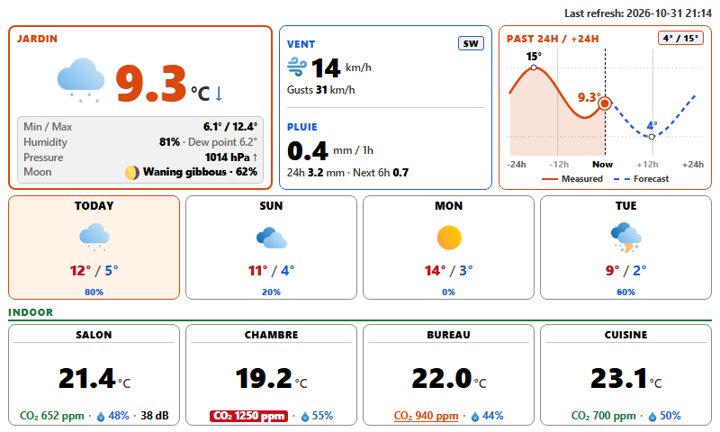
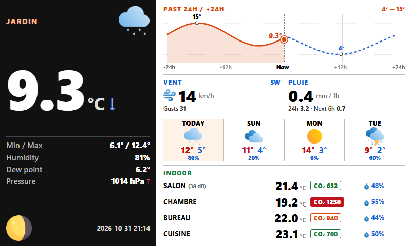
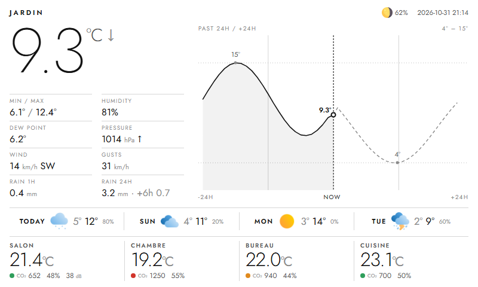

# InkyPi-Netatmo

Plugin [InkyPi](https://github.com/fatihak/InkyPi) pour votre station météo [Netatmo](https://www.netatmo.com/) : relevés des modules intérieurs/extérieurs, graphique de température -24h / +24h, prévisions à 4 jours et phase de lune sur votre écran e-paper.

*English: see [README.md](README.md).*



Thèmes **Poster** et **Minimal** (au choix dans les réglages, avec Classic) :





**Statut :** maintenu activement.

## Fonctionnalités

- **Module extérieur** : température et tendance, min/max du jour, humidité, point de rosée, pression, icône météo et phase de lune.
- **Anémomètre** (vitesse, rafales, direction) et **pluviomètre** (1h, 24h, 6h à venir).
- **Station principale + 3 modules intérieurs** : température, humidité, CO₂ (pastille verte / orange / rouge) et bruit.
- **Graphique** : températures mesurées sur 24h et prévision Open-Meteo sur 24h.
- **Prévisions à 4 jours** avec probabilité de pluie.
- **Position lue depuis votre station** ; saisie manuelle possible pour la remplacer.
- **Unités** automatiques (selon votre compte Netatmo), métriques ou impériales.
- 5 langues, toutes résolutions, paysage et portrait.
- Robuste : renouvellement et sauvegarde automatiques du refresh token ; en cas de panne Netatmo, dernières données affichées avec un bandeau « hors ligne ».

## Installation

```bash
inkypi plugin install netatmo https://github.com/k2v1n58/InkyPi-Netatmo
```

Ou copiez le dossier [`netatmo`](netatmo) dans `InkyPi/src/plugins/` puis `sudo systemctl restart inkypi.service`.

## Clés API

1. Connectez-vous sur <https://dev.netatmo.com/> → **My Apps → Create** : notez le **Client ID** et le **Client Secret**.
2. Dans l'application, section **Token generator** : cochez le scope **`read_station`** → **Generate Token** → copiez le **Refresh Token**.
3. Dans InkyPi → **API Keys**, ajoutez `NETATMO_CLIENT_ID`, `NETATMO_CLIENT_SECRET` et `NETATMO_REFRESH_TOKEN`.

Le refresh token change à chaque renouvellement : le plugin le garde dans `token_cache.json` et le réécrit dans votre `.env`. Si vous en générez un nouveau, collez-le simplement dans **API Keys**.

Limites : Netatmo 50 requêtes / 10 s (gratuit, usage personnel) ; Open-Meteo gratuit, sans clé, usage non commercial.

## Réglages

Langue, thème (Classic, Poster ou Minimal), unités, latitude/longitude (**vide = position de votre station Netatmo**), éléments affichés, modules actifs, nom de station (si plusieurs), noms personnalisés des modules.
