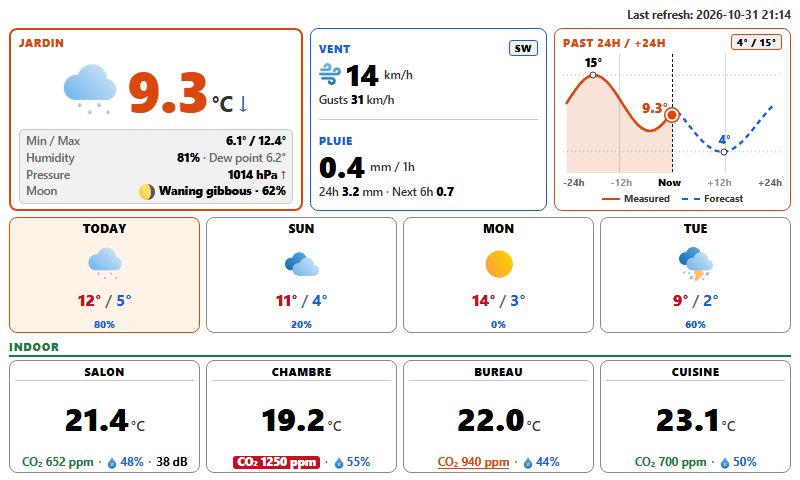
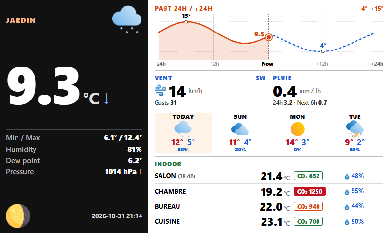
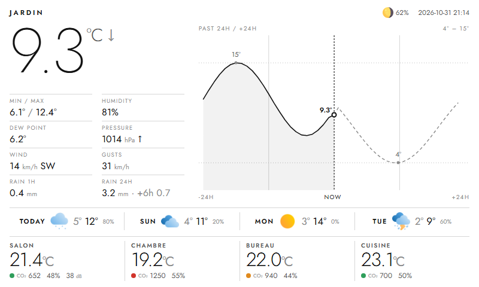
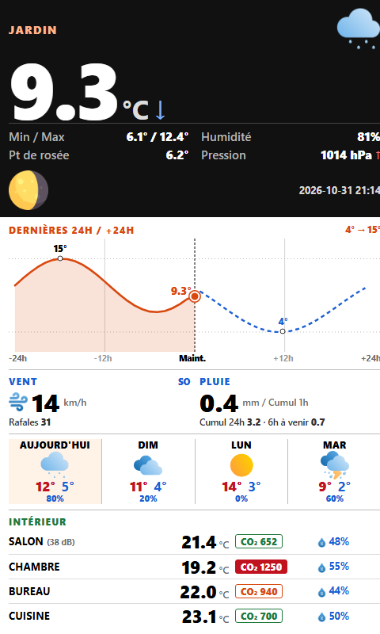

# InkyPi-Netatmo

*Netatmo* is a plugin for [InkyPi](https://github.com/fatihak/InkyPi) that displays the live readings of your [Netatmo](https://www.netatmo.com/) weather station with a −24h / +24h temperature graph, a 4-day forecast and the moon phase.

*Français : voir [README.fr.md](README.fr.md).*

Three themes, selectable in the settings:

**Classic**



**Poster**



**Minimal**





**Development status:** actively maintained.

## Features

- **Outdoor module**: temperature with trend, min/max of the day, humidity, calculated dew point, barometric pressure, current weather icon and moon phase.
- **Wind gauge** (speed, gusts, direction) and **rain gauge** (1h, 24h and the next 6h from the forecast).
- **Main station + up to 3 extra indoor modules**: temperature, humidity, CO₂ with a status colour (green / orange / red badge) and noise.
- **Graph**: measured outdoor temperature of the last 24h and Open-Meteo forecast of the next 24h on one timeline.
- **4-day forecast** with rain probability.
- **Location from your station**: latitude/longitude are read from Netatmo automatically; you can override them manually.
- **Units**: automatic (follows your Netatmo account), metric or imperial.
- 5 languages (English, Français, Español, Italiano, Deutsch), any resolution, landscape and portrait.
- Resilient: the OAuth refresh token is renewed and stored automatically, and the last readings are shown (with an "offline" badge) if Netatmo is temporarily unreachable.

## Installation

On your InkyPi:

```bash
inkypi plugin install netatmo https://github.com/k2v1n58/InkyPi-Netatmo
```

Or manually: copy the [`netatmo`](netatmo) folder into `InkyPi/src/plugins/` and restart the service (`sudo systemctl restart inkypi.service`). Update by running the install command again. No extra Python dependency is required.

## External APIs

| API | Used for | Key | Cost / limits |
|---|---|---|---|
| [Netatmo Connect – Weather](https://dev.netatmo.com/apidocumentation/weather) | Your station's readings, history and location | Yes (OAuth2, see below) | Free for personal use. Rate limit: 50 requests / 10 s, 500 / hour per user. A refresh uses 2–3 requests. |
| [Open-Meteo](https://open-meteo.com/en/docs) | 4-day and hourly forecast | No | Free for non-commercial use, 10 000 calls/day. |

### Getting your Netatmo credentials

1. Sign in on <https://dev.netatmo.com/> with your usual Netatmo account.
2. **My Apps → Create** an app (any name, e.g. `InkyPi`). Note the **Client ID** and **Client Secret**.
3. In the app page, open **Token generator**, tick the scope **`read_station`** and click **Generate Token**.
4. Copy the **Refresh Token**.
5. In the InkyPi web UI open **API Keys** and add:
   - `NETATMO_CLIENT_ID`
   - `NETATMO_CLIENT_SECRET`
   - `NETATMO_REFRESH_TOKEN`

> **Token handling.** Netatmo issues a new refresh token on each renewal and invalidates the old one. The plugin keeps the current token in `token_cache.json` (inside the plugin folder) **and** writes it back to your `.env`. If you ever generate a new token yourself, just paste it in **API Keys**: it takes precedence over the cache.

## Settings

| Setting | Description |
|---|---|
| Language / Theme / Units | Display language; **Classic** (cards), **Poster** (big inverted outdoor panel) or **Minimal** (typography only); automatic, metric or imperial units. |
| Latitude / Longitude | Optional. Empty = location of your Netatmo station. Fill both to override. Used for forecast and moon orientation. |
| Display | Refresh time, 4-day forecast, temperature graph, moon phase. |
| Netatmo modules | Show/hide outdoor, wind, rain, main indoor and 3 extra indoor modules. |
| Station name | Only needed if your account has several stations (first one is used otherwise). |
| Custom module names | Rename any module (defaults to the names set in the Netatmo app). |

Without GPS coordinates and without station location, the forecast and moon phase are simply hidden.

## Troubleshooting

- *"Netatmo credentials missing"*: add the three keys on the API Keys page.
- *"token refresh failed (400…)"*: the refresh token was revoked or the scope is wrong; generate a new one with scope `read_station`.
- Missing module: it must be reachable in the Netatmo app, and the matching switch must be on.
- The generated image is blank or errors with a screenshot failure: check that Chromium is installed (see InkyPi's troubleshooting guide).

## Development

```bash
pip install pytest requests pytz
pytest            # tests of the helpers and of the OAuth/API client
```

Structure: `netatmo/netatmo.py` (plugin), `netatmo_api.py` (OAuth + API client), `helpers.py` (units, moon, forecast, graph), `icons.py`, `i18n/` (translations), `render/` (HTML/CSS template), `settings.html`.

## Credits

Weather and moon icons are from InkyPi's weather plugin. Forecast data by [Open-Meteo](https://open-meteo.com/) (CC BY 4.0). The moon phase uses Jean Meeus' *Astronomical Algorithms*.

## License

This project is licensed under the GNU GPL v3, like InkyPi, because it reuses InkyPi's icons. See [LICENSE](LICENSE).
